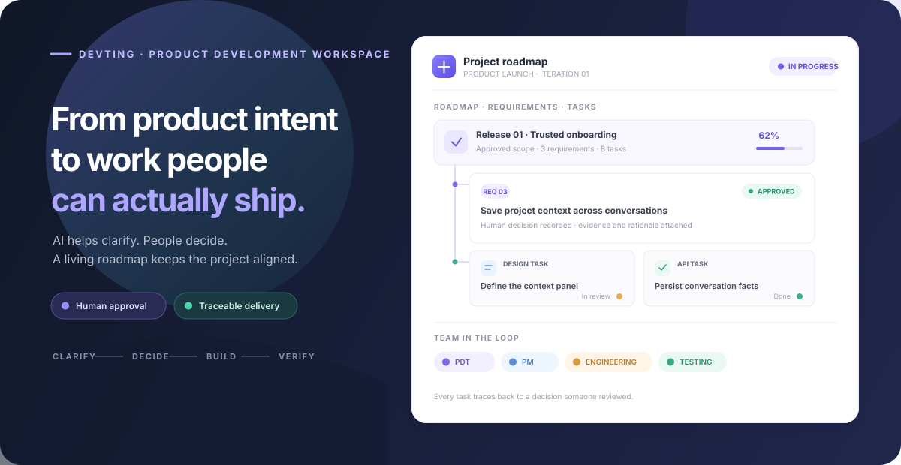

# 织点 DevTing —— 从产品想法走向清晰可交付的路线图

<p align="center">
  <a href="README.md">English</a> · <a href="README.zh-CN.md">简体中文</a>
</p>

<p align="center">
  
</p>

<p align="center">
  
  
  
  
</p>

> **开发阶段的本地 MVP。** 织点探索一种更有序的软件开发方式：先说清方向，让人掌握关键决策，并保存通常会消失在长对话里的推理和进展。产品仍在迭代，尚非生产级或多人协作服务。

## 为什么做织点

软件开发最费时间的部分往往是决定做什么、为什么值得做，以及怎样才算完成。织点把这部分工作纳入研发流程：AI 协助澄清问题并整理建议，**由用户决定需求范围**，团队再把确认后的需求转化为相互关联的设计、开发和测试工作。

路线图、角色会话、决策、会议纪要和文档版本都保存在本地项目空间中，让工作不必依赖一段不断变长的聊天记录。

## 当前能做什么

- **带着上下文创建项目**：记录目标、产品形态、初始问题以及瀑布、敏捷或混合开发模式。新项目提供引导流程，并从空白需求基线开始。
- **AI 分析需求，用户把关**：PDT 和产品角色整理价值假设、证据缺口及 Kano 类型建议。用户可以确认、修改、拒绝或暂缓；只有确认后的需求进入正式基线。
- **把已批准范围变成协同工作**：PM 创建关联角色任务和验收标准，并跟踪 UI、研发、测试等工作从需求到评审和完成的过程。
- **查看树形动态路线图**：逐层展开阶段、需求、任务和交付物；检查节点状态与项目事件；为任务设置串行或并行，并通过服务端控制项目并行上限。
- **配置 AI 团队**：提供 PDT、PM、系统、产品、UI、前端、后端、大数据、算法、测试和运维 11 类角色，可配置人数、提示词和汇报关系。
- **按角色选择 Runtime**：可使用平台 Deep Agents、Codex CLI 或 Claude Code CLI。外部 CLI 在运行服务的机器上对指定本地仓库执行，不会收到平台模型密钥。
- **统一维护项目记忆与交付物**：管理产品需求包、PRD、概要与详细设计、测试和自测大纲、运维记录、决策及文档版本。
- **先审阅会议和决策，再改变计划**：可手动开会或启用本地定时会议。AI 提出的行动项需要用户确认后才会创建任务。
- **清晰阅读并导出项目**：聊天和项目视图统一渲染 Markdown；支持导出需求 CSV、交付摘要 Markdown，以及包含项目历史和文档版本的 JSON。

Kano 标签是附有理由和证据缺口的建议，不是经过验证的市场研究结论。路线图展示 Agent 步骤和已保存的项目事件，不代表 token 级流式输出或分布式多 Agent 调度。

## 以人工裁决为核心的项目流程

1. **创建项目**：描述问题、目标用户、产品形态和开发模式。
2. **与 PDT 经理澄清**：区分证据与假设，找出仍待回答的问题。
3. **审阅需求建议**：查看 Kano 候选类型、分析理由、置信度和证据缺口。魅力型需求在具备时可能带来惊喜，缺失时通常不会造成同等不满。
4. **决定需求范围**：确认、修改、拒绝或暂缓。确认后建立需求基线并交由 PM 拆解；其他选择不会创建研发任务。
5. **在路线图跟进工作**：展开阶段，查看需求、角色任务、依赖、交付物和事件记录；调整并行上限及任务执行方式。
6. **审阅工作和交付物**：跟进验收标准、测试、设计文档、决策与会议行动项。AI 建议在用户接受之前始终可审阅。

## 快速开始

需要 Python 3.12 或更新版本。先安装依赖并创建本地环境：

```bash
git clone https://github.com/ZXTFINAL/DevTing.git
cd DevTing
python3.12 -m venv .venv
source .venv/bin/activate
python -m pip install -r requirements.txt
cp .env.example .env
```

在 `.env` 中的 `DEEPSEEK_API_KEY` 填入你自己的 DeepSeek API Key，然后启动：

```bash
uvicorn backend.app:app --host 127.0.0.1 --port 8765
```

打开 <http://127.0.0.1:8765/> 并创建项目。未配置模型 Key 时，仍可查看和编辑本地项目数据及文档，但 AI 对话、需求分析、PM 自动拆解和会议不可用。供应商密钥只放在服务端 `.env` 中，不要提交到仓库或粘贴进浏览器代码。

### 为角色连接编码 Runtime

在**团队**页打开角色设置，选择平台 Runtime、Codex CLI 或 Claude Code。使用 CLI 时，填写本地代码仓库的绝对路径。运行 DevTing 的机器必须安装并登录相应 CLI。“命令可用”只表示检测到可执行文件，实际登录情况会在调用 Runtime 时验证。

外部 Runtime 可以检查或编辑配置的代码仓库，但目前没有直接访问 DevTing 数据库的工具。它的报告会同步到角色会话和项目群；需要写入结构化项目数据时由平台角色负责。平台 Runtime 保留项目需求、任务和文档工具。

## 配置项

| 变量 | 用途 |
| --- | --- |
| `DEEPSEEK_API_KEY` | DeepSeek API Key；调用真实模型时必填。 |
| `DEEPSEEK_BASE_URL` | OpenAI 兼容接口地址，默认 `https://api.deepseek.com`。 |
| `DEEPAGENTS_MODEL` | Deep Agents 模型标识，默认 `openai:deepseek-flash`。 |
| `DEVTING_DB_PATH` | 可选 SQLite 路径；默认 `.data/zhidian.sqlite3`。 |

默认情况下服务只监听 `127.0.0.1`。未配置认证、访问控制、备份和数据保留策略前，不要将服务公开到互联网。定时会议默认关闭，只有本地服务运行时才会触发。

## 技术结构

```text
浏览器（HTML / CSS / JavaScript）
                 │ HTTP / JSON
FastAPI ─────────┼── Deep Agents + OpenAI 兼容模型
                 └── SQLite（项目状态、审计事件、文档版本）
```

- `backend/app.py`：API、项目状态、SQLite 持久化、Deep Agents 编排和调度。
- `app.js`、`styles.css`、`index.html`：单页工作台和交互。
- `docs/`：产品愿景、需求、PRD、软件设计、测试、运维和决策记录。

## 运行隔离集成检查

```bash
python -m pip install -r requirements-dev.txt
python -m unittest discover -s tests -v
```

测试使用临时 SQLite 数据库和确定性的角色替身，不调用真实模型，也不读写 `.data/zhidian.sqlite3`。覆盖项目创建、需求审批门禁、PM 拆解、任务评审验收、会议行动项、记忆审阅、文档版本、导出、项目隔离，以及通过假 CLI 验证的逐角色 Runtime 路由。测试通过不代表真实模型输出、完整浏览器流程或供应商 CLI 登录及输出兼容性已验收。详见[闭环测试报告](docs/test-report-2026-10-13-closed-loop.md)。

## 当前边界

这是一个本地单用户 MVP。仍需完成浏览器全流程验收、跨项目和设备的易用性验证、真实模型质量与成本控制、会议中断恢复、数据导入、备份恢复演练、多用户访问控制和并发写入控制。不同开发模式目前共享进度跟踪和阶段说明，尚未覆盖所有强制阶段门禁。角色汇报关系用于 Agent 上下文和项目记录，不是完整的实时团队消息系统。

更多详情见[测试记录](docs/test-report-2026-10-09.md)、[测试大纲](docs/test-outline.md)及以下产品和设计文档。

## 产品与设计文档

- [产品愿景与创始人构想](docs/product-vision.md)
- [产品需求包](docs/product-requirements-package.md)
- [产品需求文档 PRD](docs/PRD.md)
- [软件概要设计](docs/software-high-level-design.md)
- [软件详细设计](docs/software-detailed-design.md)
- [测试大纲](docs/test-outline.md) · [自测大纲](docs/self-test-outline.md)
- [Roadmap 核验记录](docs/test-report-2026-10-13-roadmap.md)
- [Markdown 和角色 Runtime 核验记录](docs/test-report-2026-10-13-markdown-runtime.md)
- [闭环集成测试报告](docs/test-report-2026-10-13-closed-loop.md)
- [部署运维大纲](docs/operations-outline.md) · [决策和待确认问题](docs/decisions-and-open-questions.md)

## 许可证

项目尚未选择许可证。在添加许可证之前，请勿假定可以复用、修改或再分发代码。
